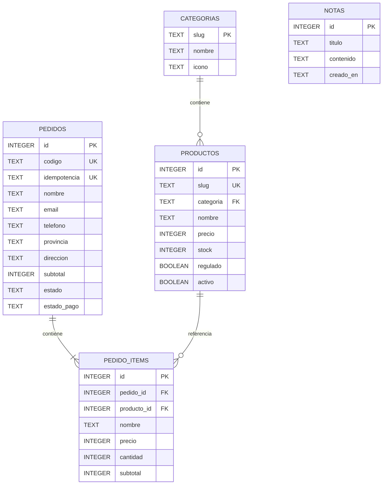

# Modelo de datos (DER)

Las notas son independientes por exigencia del Laboratorio #5. El detalle del pedido conserva el nombre y precio de venta del artículo, evitando que futuros cambios al catálogo alteren los pedidos históricos. Los clientes se agrupan por correo a partir de pedidos y no requieren una tabla adicional en esta versión.
