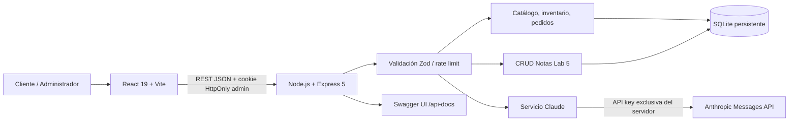

# Arquitectura de GrowLab

## Reglas de negocio verificables

1. El frontend **no lee ni recibe** `ANTHROPIC_API_KEY` ni el secreto de administración.
2. Los precios, el stock y los artículos de cada pedido se recalculan exclusivamente en el backend; nunca se confía en el subtotal enviado por el navegador.
3. Cada solicitud de pedido se ejecuta dentro de una transacción SQLite. Si un artículo no tiene stock suficiente, **no se crea el pedido ni se descuenta ningún stock**.
4. Una `Idempotency-Key` válida evita aplicar dos veces el mismo pedido.
5. Al cancelar un pedido, el stock se reintegra una vez. No se puede reabrir un pedido cancelado.
6. El código de pedido y el correo son necesarios para consultar su estado sin revelar la lista administrativa.
7. El backend valida existencias, precios e idempotencia antes de registrar los pedidos, y la transacción actualiza el stock.
8. El panel administrativo requiere contraseña configurada fuera de Git, sesión firmada, cookie HttpOnly y cabecera adicional para mutaciones.
9. La API Claude se limita por tasa y rechaza solicitudes inválidas antes de gastar créditos.
10. **Sin pasarela de pago**: cada pedido genera una solicitud con `estado_pago = pendiente`.

## Recursos del sistema

- Categorías 9, productos iniciales 35.
- Base: `categorias`, `productos`, `pedidos`, `pedido_items`, `notas`.
- Frontend: catálogo, búsqueda, filtros, ordenación, detalles, carrito, checkout con registro de pedido, seguimiento, asistente, administración y notas.
- Administración: KPIs, gestión de estados, inventario, clientes derivados de los pedidos y notas.

## Documentación viva

- Swagger UI: `http://localhost:3000/api-docs`
- Especificación JSON: `http://localhost:3000/api/openapi.json`
- Health: `http://localhost:3000/api/health`
